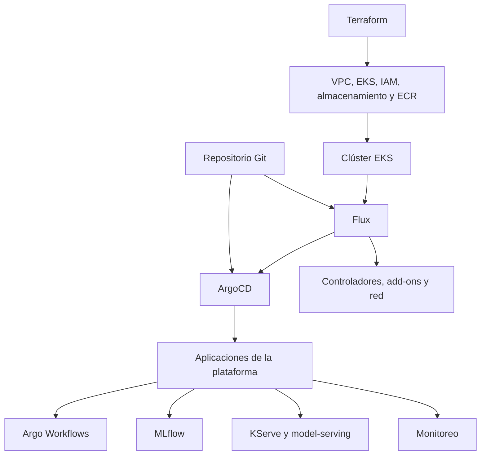
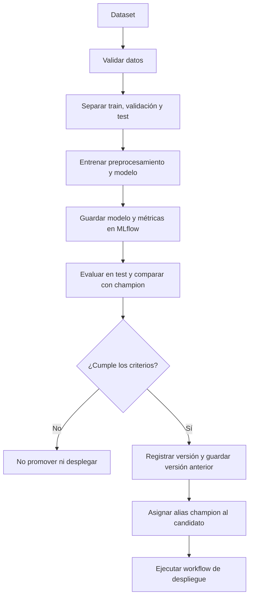
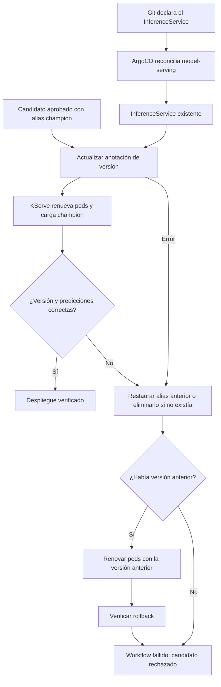
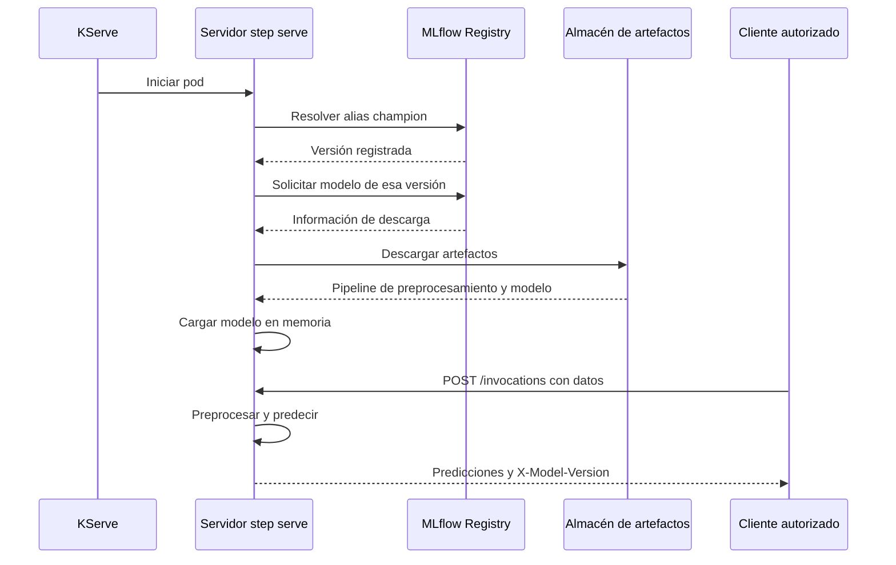
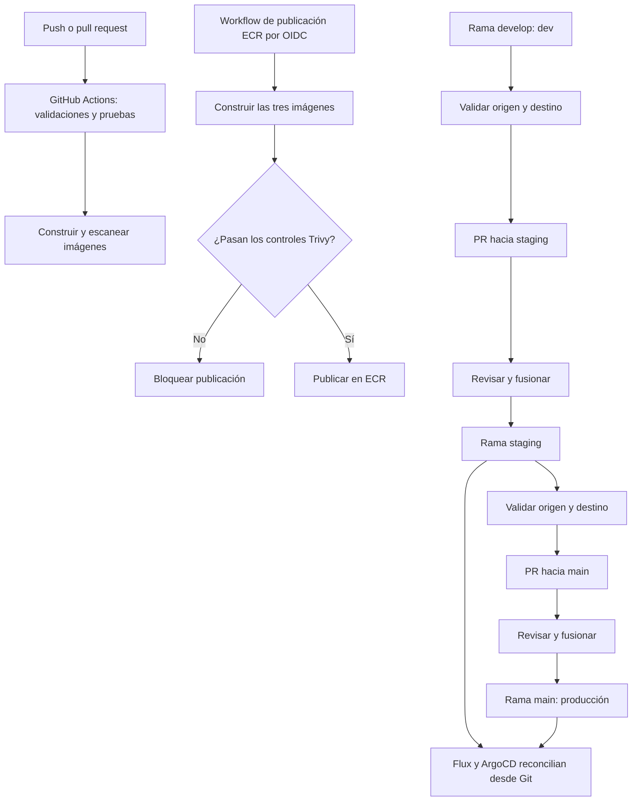

# Flujos básicos de la plataforma

[Índice de documentación](../README.md) · [Arquitectura](implementation.md) · [Estado actual](../project/backlog.md)

Estos diagramas describen el código y los manifiestos del repositorio. La validación del despliegue
completo en AWS sigue pendiente; el backlog recoge la evidencia y los bloqueos.

## Arquitectura y responsabilidades

Terraform administra los recursos AWS; Flux, la infraestructura del clúster; ArgoCD, las aplicaciones.
Las flechas representan aprovisionamiento y reconciliación, no tráfico de red.

Fuente: [organización del repositorio](../../AGENTS.md#repository-layout).

## Entrenamiento y aprobación

Argo ejecuta los pasos con la imagen compartida `mlops-platform`. El preprocesamiento viaja
con el modelo en un `Pipeline` de scikit-learn. Si aún no existe un champion, la evaluación
aplica los umbrales del candidato sin comparación con una versión anterior.

Fuentes: [pipeline principal](../../gitops/applications/apps/argo-workflows/base/workflow-templates/ml-pipeline-template.yaml),
[entrenamiento](../../gitops/applications/apps/argo-workflows/base/workflow-templates/model-training-template.yaml)
y [pasos Python](../../ml-platform/src/pipelines/steps.py).

## Despliegue y rollback del modelo

KServe usa el modo `Standard` y una actualización gradual de pods (`RollingUpdate`).
El alias decide qué modelo cargar; la anotación dispara la renovación. Un rollback también
se verifica y no convierte el despliegue fallido en un éxito. Si falla la restauración,
el workflow permanece fallido.

Fuentes: [workflow de despliegue](../../gitops/applications/apps/argo-workflows/base/workflow-templates/model-deployment-template.yaml)
y [InferenceService](../../gitops/applications/apps/model-serving/base/inference-service.yaml).

## Carga del modelo e inferencia

El alias se resuelve al arrancar, no en cada petición. El acceso al almacén depende del entorno
y de la configuración de MLflow: gateway compatible con S3 en desarrollo, S3 en producción.
El diagrama resume la carga; omite los saltos internos del proxy de artefactos.
El cliente debe tener conectividad y permisos de red; aquí no se presupone un endpoint público.

Fuente: [servidor de inferencia](../../ml-platform/src/pipelines/serving.py).

## CI, publicación y promoción de entornos

Publicar imágenes y promover configuración son flujos distintos. El workflow de promoción
crea o reutiliza un PR entre ramas; no aplica recursos al clúster directamente.
La promoción del mismo digest ECR entre entornos sigue pendiente en el backlog (#65).

Fuentes: [CI](../../.github/workflows/ci.yml), [imágenes](../../.github/workflows/ml-platform-image.yml),
[publicación ECR](../../.github/workflows/publish-ecr.yml) y
[promoción](../../.github/workflows/environment-promotion.yml).
